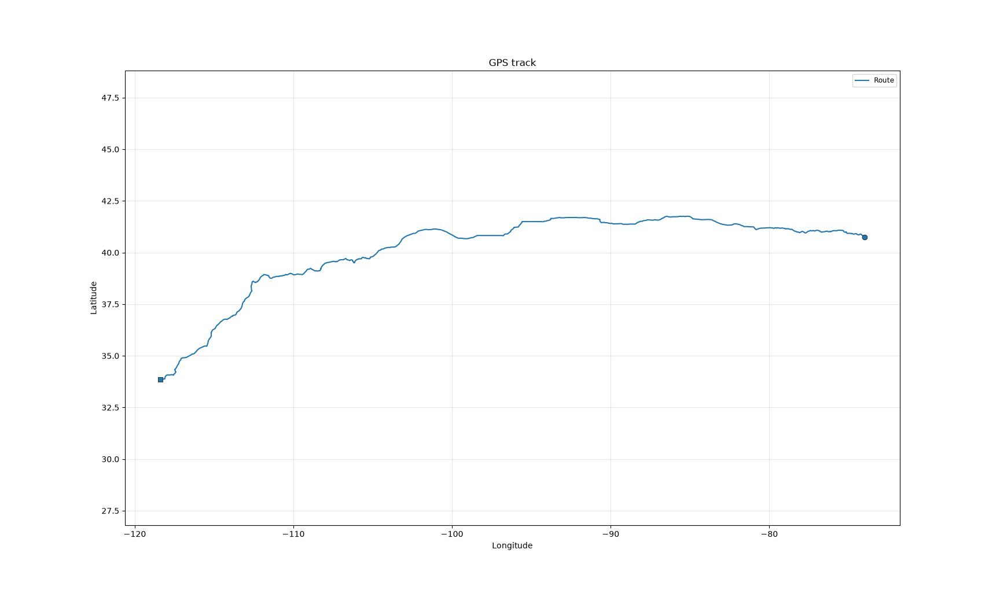
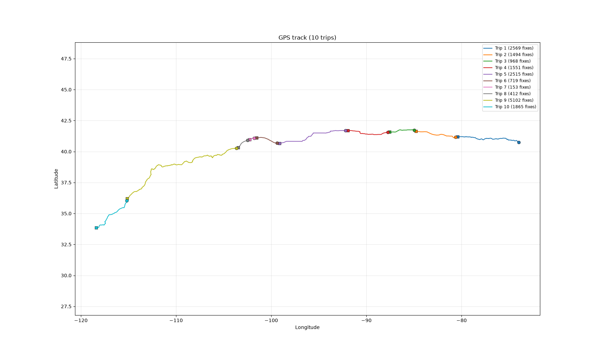

# GPS Fixes to Trip List Tool

**install with:**

`pip install git+https://github.com/clorton/triplist`

This installs the `samsara` package along with four console scripts:
`samsara-get-data`, `samsara-prep-data`, `samsara-plot`, and
`samsara-solve`. Each script's functionality is also importable directly,
e.g. `from samsara.solution import get_trips`.

## Supporting Utilities - Generated by Claude Code

1. `samsara-get-data` (`samsara.route_gps_sim`) - obtains sample GPS fixes for the route between two given addresses

e.g. 

```bash
samsara-get-data "142 E 31st St, New York, NY 10016" "260 Portofino Way, Redondo Beach, CA 90277" -o fixes.csv
```

(Those are the start and end addresses of the [Cannonball Run](https://en.wikipedia.org/wiki/Cannonball_Run_challenge))

2. `samsara-prep-data` (`samsara.prep_data`) - breaks the trip into smaller segments (`--num-gaps` argument) and shuffles the entries so they are not in timestamp order

e.g.

```bash
samsara-prep-data fixes.csv -o shuffled.csv --num-gaps 9
```

Creates 10 separate trips.

3. `samsara-plot` (`samsara.plot`) - plots the trip(s) for visual inspection

e.g.

```bash
samsara-plot fixes.csv
```



or

```bash
samsara-plot shuffled.csv
```



## Solution - handcoded by Christopher

4. `samsara-solve` (`samsara.solution`) - reconstructs trips (contiguous runs of fixes separated by gaps of at least `--max-gap` seconds) from a shuffled fixes CSV and reports each trip's distance

e.g.

```bash
samsara-solve shuffled.csv --max-gap 600
```

The thrust of this code is to organize the GPS fix data into NumPy arrays which can be efficiently processed vector style. This would be much more efficient for longer trips with thousands of GPS fixes. The sample generator can generate fixes at 1 second intervals if desired. The current code, with no special optimization, processes 173k GPS samples in 240 milliseconds on my machine.

Also, the array layout would be easy to process in parallel on a multi-core machine or process on GPU if appropriate.

```python
def get_sorted_data(fixes: list[Point]) -> tuple[NDArray[np.uint64], NDArray[np.float64]]:
    # Extract the timestamps into a NumPy array
    stamps = np.array([f.ts for f in fixes], dtype=np.uint64)
    # extract the points (lat, lon) into a 2-D NumPy array
    points = np.array([[f.lat, f.lon] for f in fixes], dtype=np.float64)
    # get the indices of the data in timestamp order
    indices = np.argsort(stamps)
    # reorder the timestamp and point data in sorted order
    stamps, points = np.array(stamps[indices], dtype=np.uint64), points[indices,:]

    return stamps, points
```

```python
def get_trips(stamps: NDArray[np.uint64], points: NDArray[np.float64], vehicle_id: str, max_gap: int) -> list[Trip]:
    # Calculate the deltas between consecutive timestamps
    deltas = np.diff(stamps)
    # Identify the indices of gaps >= max_gap
    gaps: NDArray[np.intp] = np.nonzero(deltas >= max_gap)[0]
    # Append the end index of the last trip
    gaps = np.append(gaps, len(stamps)-1)

    trips = []
    ifirst = 0
    for ilast in gaps:
        if ilast > ifirst: # normal case of multiple GPS fixes in a sequence
            # [ifirst:ilast] specifies the first N-1 points, e.g. 0...N-1
            # [ifirst+1:ilast+1] specifies the last N-1 points, e.g. 1...N
            dists = hdist(points[ifirst:ilast,:], points[ifirst+1:ilast+1,:])
            dist = dists.sum()  # length of this segment is the sum of the distances between the fixes
        else: # degenerate case of a lone GPS fixes
            dist = 0
        trips.append(Trip(vehicle_id, int(stamps[ifirst]), int(stamps[ilast]), float(dist)))
        ifirst = ilast + 1

    return trips
```
